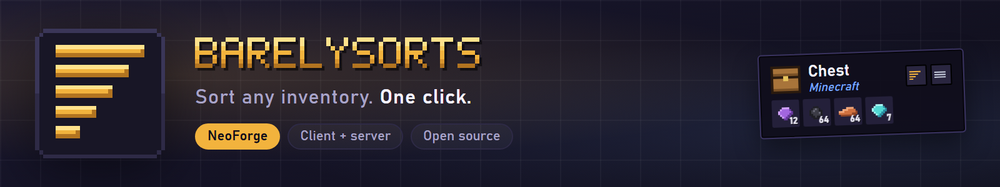
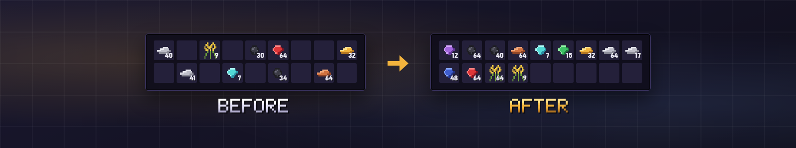

**Sort any inventory with one click: a sort button and a settings button on every chest, barrel and your own pack.**

BarelySorts adds two small buttons to each storage inventory. Press the sort button, or middle-click or press a key over the group, and the items merge into full stacks and line up the way you like. Nothing else changes: your hotbar stays where it is, and crafting grids, furnaces and other machines are left alone.

- **Sorts storage:** chests, barrels, shulker boxes, hoppers, droppers and your main inventory. Partial stacks merge into full stacks first.
- **Rows or columns:** fill left to right then top to bottom, or top to bottom then left to right.
- **Sort by** quantity, item name or mod name.
- **Locks:** lock a whole group so sorting skips it, or lock single slots and keep a favorite item exactly where it is. Locked slots get a faint gold outline.
- **Hotbar autofill:** when the last item in a hotbar slot is used up, the same item moves in from your main inventory. Tools can swap at 1 durability or only once they break.
- **Mass delete:** hold a key (X by default) and click slots to mark them in red. Let go to see the list of stacks with counts, then confirm to empty them.
- **Quick-move shortcuts:** Ctrl-click moves one item, Shift-Ctrl-click moves every item of that type, and holding Shift and the left mouse button while dragging over slots moves each stack you pass.
- **ModJS scripting:** with ModJS installed, scripts can listen to sorts, quick moves, deletes and autofill, cancel them, read a player's sort mode and locks, and define their own categories and sort orders.
- **Server-safe:** sorting runs on the server, so it stays correct in multiplayer.
- **Plays nicely with other mods:** Applied Energistics 2 screens are not touched. BarelySorts adds no items, blocks or recipes, so it needs no JEI, REI, EMI or BEI support, and sorting only reacts when the mouse is over an inventory group.

- **Sort button:** the bars-of-falling-length glyph on the group's top right corner.
- **Settings button:** the three-bar glyph next to it opens that group's sort method, sort by and lock options.
- **Middle-click** a group, or press **R** over it, to sort it without the button.
- All keys show up in **Controls** under BarelySorts, so you can rebind them.

Each group remembers its own sort method, sort by and locks. Open the settings button on a chest, or on your own inventory, to change them. Your inventory also has the autofill tool-swap option.

One jar per Minecraft version (1.20.1, 1.21.1, 26.1.2, 26.2, 26.3) works on Forge, NeoForge and Fabric. On 1.20.1, NeoForge uses the Forge 1.20.1 jar.

**Does it sort my hotbar?** No. The hotbar never sorts and never moves.

**Does it work on a server?** Yes. Sorting is done by the server, so everyone sees the same result.

**Can I use it in my modpack?** Yes. It's MIT licensed.

Source and issues on [GitHub](https://github.com/ItMeCasey/BarelySorts).
